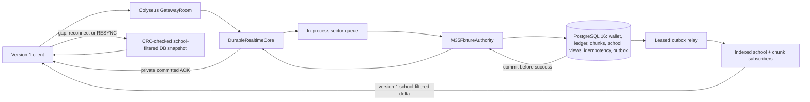

# M3.5 — end-to-end integration gate

**Status, 2026-10-10:** synthetic PostgreSQL-backed protocol-v1 integration implemented and tested. This is a review submission, not authorization for M4 or production gameplay. The 1,000-client, 250-actions/s hotspot stage did **not** converge within its 10-second post-ACK drain window in either trial. Higher-capacity readiness is unapproved.

## Integrated contract and boundaries

The existing Colyseus `GatewayRoom` accepts the version-1 binary envelope and synthetic token identity. A dedicated `DurableRealtimeCore` validates commands, uses the existing sector queue and bounded outbound queue, and delegates to `M35FixtureAuthority`. The authority calls the M3 PostgreSQL transaction with an explicit synthetic `fixture-credit` cost. No owner gameplay cost, running conversion, gacha, gift, live campaign identity or production mutation opcode is enabled. The generic 16-slot registry remains synthetic; proposed V1 school IDs are not stored.



The separate durable core preserves the GatewayRoom, sector-serialization, outbound-queue and v1 wire boundaries. It exists because the M2 `RealtimeCore` is intentionally ephemeral and its in-memory world cannot be the durable authority. Some transport routing is duplicated and should be consolidated only after the synthetic integration is reviewed; no distributed sector process or Redis was introduced. One server process owns the current fixture authority. Cross-process writer fencing and event publication remain future architecture gates.

```mermaid
sequenceDiagram
  participant Client
  participant Gateway
  participant Sector
  participant PG as PostgreSQL transaction
  participant Outbox
  Client->>Gateway: EXPLORE(key, tile, fixture rule 0)
  Gateway->>Sector: validate identity, rate and frame; enqueue
  Sector->>PG: claim key + verify payload hash; lock chunk head
  PG->>PG: debit wallet + ledger; full chunk/fog; school view revision; result; outbox
  PG-->>Sector: COMMIT
  Sector-->>Client: committed ACK or stored retry result
  Outbox->>PG: lease committed event
  PG-->>Outbox: school-projected event
  Outbox-->>Client: ordered v1 DELTA to matching subscribers
  Outbox->>PG: mark delivered by lease token
  Note over Client,PG: On a gap/reconnect, load the authoritative school-filtered snapshot.
```

The database transaction contains the full chunk write selected by ADR-011, per-school fog and view revision, wallet debit, ledger entry, idempotency outcome and outbox event. Success is ACKed after commit. A postcommit failure closes the session; a retry after restart replays the saved result. A duplicate key with a different canonical payload is rejected. Outbox delivery is at least once. On an invalid projection, the relay requests subscriber snapshots and quarantines the event in an auditable table; it never publishes a hidden or malformed mask. Migration 2 makes the campaign write strategy immutable and requires exact synthetic registry agreement at startup.

## Validation

Isolated **PostgreSQL 16.15**, loopback port 55433, with `fsync`, `synchronous_commit` and `full_page_writes` enabled. A new disposable `r2pl_m35_final` database received migration 1 and migration 2; migration 2 was rerun to verify checksum repeatability. The M3/M3.5 test suite passed **24/24**, including actual Colyseus sockets and database transactions. M3.5 cases cover ACK after debit, same-key replay and conflicting payload, 30 concurrent same-wallet/hot-chunk writes and 12 same-tile no-change requests, school-slot 0/15 isolation, resync, restart, forced process termination after commit before ACK, and malformed-outbox quarantine plus snapshot recovery. The earlier M3 suite covers precommit rollback, mutation-log recovery, checkpoint races and lease behavior. Typecheck, Biome lint, client build and source-size report passed. CI now runs both migrations and the PostgreSQL-backed test suite in its disposable PostgreSQL 16 service; GitHub execution awaits an owner-selected V2 remote.

## Integrated load measurements

Windows desktop, Intel i5-13400F (16 logical CPUs), 34.2 GB RAM, Node 24.19.0. The server and generator were **separate Node processes on the same host**, using loopback sockets and the same PostgreSQL 16 instance. Each client subscribed to one chunk in one of two synthetic schools. Balanced actions spanned 16 sectors; hotspot actions directed 70% to one sector/chunk. The durable core always uses **indexed school/chunk fanout**. Early benchmark filenames incorrectly said `scan`; final artifacts correct only that metadata and filename to `indexed`. ACK and latency figures are p95 milliseconds. The visible number samples 20 actor clients; final convergence checks every subscribed mask/fog replica. Application frame bytes exclude WebSocket/TCP framing. The 10-second post-ACK convergence timeout is a test bound, not evidence of permanent divergence.

| Clients / pattern / request rate | ACKed | ACK p95 | DB transaction p95 | Sector queue wait p95 | Commit→client ACK p95 | Commit→client visible p95 | Fanout recipients | WAL/action | Result |
|---|---:|---:|---:|---:|---:|---:|---:|---:|---|
| 100 balanced / 50/s | 400/400 | 31.9 | 29.5 | 71.5 | 0.8 | 1.9 | 2,500 | 3,802 B | Converged |
| 100 hotspot / 50/s | 400/400 | 30.4 | 25.5 | 54.2 | 0.9 | 26.9 | 10,610 | 4,006 B | Converged |
| 500 balanced / 100/s | 1,000/1,000 | 18.8 | 16.7 | 171.3 | 0.6 | 2.6 | 31,252 | 4,035 B | Converged |
| 500 hotspot / 100/s | 1,000/1,000 | 28.8 | 20.5 | 217.2 | 1.3 | 59.0 | 132,927 | 3,937 B | Converged |
| 1,000 balanced / 250/s | 2,500/2,500 | 47.1 | 43.5 | 252.8 | 0.9 | 385.2 | 156,252 | 3,981 B | Converged, high visible delay |
| 1,000 hotspot / 100/s | 1,000/1,000 | 37.9 | 28.3 | 320.0 | 2.3 | 12.8 | 265,854 | 4,090 B | Converged |
| 1,000 hotspot / 250/s, trial 1 | 2,500/2,500 | 751.4 | n/a | n/a | n/a | n/a | n/a | n/a | **Failed 10 s convergence gate**; 738 outbox events pending after shutdown |
| 1,000 hotspot / 250/s, trial 2 | 2,500/2,500 | 2,355.6 | 18.4 | 1,816.4 | n/a | n/a | 641,271 | 4,441 B | **Failed 10 s convergence gate**; 68 events pending |

All six successful runs ended with zero pending outbox rows, no client errors, no resyncs and exact final replicas. Each also replayed 10 duplicate requests and rejected 10 conflicting payloads without repeating effects. Across those runs, p95 chunk-head database lock time was **0.65–2.19 ms**, while sector queue wait rose with load. Commit-to-ACK enqueue stayed below **0.2 ms p95** in the smaller runs; commit-to-client ACK includes socket delivery and same-host scheduling. The 1,000 balanced run had 156,252 fanout recipients and 400.6 ms p95 commit-to-delta enqueue. The failed hotspot trial 2 reached 641,271 recipients, 11.64 s p95 commit-to-delta enqueue and 16/16 peak busy database connections. Its outbound queue peaked at 2 frames and observed socket buffered bytes stayed at zero, so this harness does **not** establish socket backpressure as the immediate bottleneck; relay catch-up, sector scheduling and shared-host CPU need isolation. The full artifacts include p50/p95/p99, outbound queue/socket buffer, server and generator CPU/RSS, event-loop lag, retries/conflicts, WAL, pool use and deadlocks. No deadlock was observed in completed cases. Trial 1's failed artifact predates failure-path server telemetry; its pending count was inspected directly in the disposable database after shutdown.

Separate process CPU confirms both sides contribute: the 1,000 balanced run used **10.95 server CPU-seconds** and **8.28 generator CPU-seconds**; the 500 hotspot run used **7.02 server** and **4.47 generator CPU-seconds**. Trial 2's failed hotspot consumed **17.78 server CPU-seconds** by the failure snapshot. Database CPU/memory were not independently sampled in this network harness; M3's database-only ADR-011 benchmarks supply those measurements. Pool maximum busy, WAL and lock timings are in each JSON artifact. These same-host results do not establish a production CCU ceiling or a separate-host capacity claim.

## Batching and recovery decision

Protocol v1 remains the default. The accepted M2.6 branch tested opt-in 20/50 ms ordered batches with contiguous records, school-bit validation, bounded queues, gap resync and reconnect cases on the RAM-only fixture. Its two 1,000-client same-host hotspot trials materially reduced frames, but balanced visible latency worsened and the durable pipeline has a different bottleneck. **Do not merge v2 into this baseline.** Selective 20 ms batching for hot subscriptions could avoid balanced-traffic delay, but it adds capability negotiation, mode transition/flush rules and server/client state per subscription. That is currently more complex than retaining v1 and fixing measured outbox/fanout backlog; it is a candidate for a separate controlled durable comparison after an explicit protocol approval. An old v1 server rejects v2 SUBSCRIBE, so safe fallback is not yet present. No v2 performance benefit is claimed for the PostgreSQL-backed path.

Recovery checks prove the committed result survives server termination before ACK and a new server returns the same result without another debit. A reconnect obtains a CRC-checked DB snapshot even if deltas were missed. Remaining operational work includes independent-host tests, longer hotspot runs, durable outbox catch-up and queue memory profiling, multiserver fencing/publication design if ever needed, and production identity/rule/visibility approval.

## Size, dependencies and source control

First-party source: **28 files / 129,380 bytes**; tests: **7 / 65,564 bytes**; scripts: **12 / 58,637 bytes**. Client bundle: **535,489 raw bytes / 133,880 gzip bytes**; the new server adapter does not enter the client bundle. No new dependency, ORM, broker or engine was added. The isolated v2 batching branch remains unmerged. There is no configured Git remote; the owner must supply the V2 repository/account and visibility before hosted CI can run.

## M4 readiness recommendation

The synthetic durable transaction and retry contract passes its local correctness gate. **Do not authorize full M4 yet:** the repeated 1,000-client hotspot at 250 actions/s failed the bounded visible-convergence gate, higher-capacity readiness is unapproved, and C-01/C-02/C-03/C-04/C-08/C-09 still need scoped owner decisions. A limited synthetic M4 vertical slice could be considered only after the owner reviews this report and explicitly approves its exact rule/identity/visibility scope; running API and physical rewards remain disabled and are not prerequisites. The next realtime task should isolate outbox drain and socket fanout throughput, then repeat the same hotspot workload with a clear catch-up criterion and independent load host if available.

Evidence: `docs/benchmarks/M35_*_indexed_*.json`, `tests/m35-realtime.test.ts`, `docs/M2.6_BATCHING_EXPERIMENT.md`, `docs/M4_PRODUCT_DECISION_CHECKLIST.md`, and `docs/AGENT_REVIEWS.md`.
